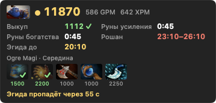

# Networth Overlay

English · **[Русский](README.md)**

A window with your net worth, timers and hints on top of Dota 2 on macOS. It also works over the game in fullscreen.



## What it shows

- **Net worth row:** net worth, GPM, XPM, hero portrait.
- **Stats:** gold, buyback, score, kill participation, streak, last hits per minute, laning result at 10:00, APM, gold sources, wards, typical hero GPM/XPM.
- **Timers:** power, bounty and wisdom runes, lotuses, stacks, day/night, Tormentor, Roshan, Aegis.
- **Help:** popular items for your hero by game stage with owned items marked, a hint line, sound reminders (a separate sound per event).
- **Spectator mode** and **last match results**.

Size, layout, transparency, scale and the set of stats are configurable. The interface is available in English and Russian. `Ctrl+Shift+H` hides and shows the window.

## Install

```bash
brew tap 6ermutka/networth-overlay https://github.com/6ermutka/networth-overlay
brew install --cask networth-overlay
```

Update with `brew upgrade --cask networth-overlay`. The app checks for new versions itself and, when installed via Homebrew, installs them (never during a game; can be turned off in settings).

Without Homebrew: download the zip from the [releases page](https://github.com/6ermutka/networth-overlay/releases/latest), unpack it into Applications and remove the quarantine flag — the app is not signed with an Apple developer certificate:

```bash
xattr -dr com.apple.quarantine "/Applications/Networth Overlay.app"
```

## Usage

1. Open Networth Overlay — the settings window and an “NW” menu bar item appear.
2. Press “Play”: Dota 2 starts through Steam with the `-gamestateintegration` option. If you launch the game from Steam yourself, add that option to the launch options.
3. The window appears during a match. To place it, press “Move the window” and drag it.

## Where the data comes from, and why this is not a cheat

- **Game State Integration** is Valve's official mechanism: Dota 2 itself sends your hero's data to `127.0.0.1`. The app only listens on a local port.
- The app does not read or modify game memory, does not inject into the game process and does not replace game files. It adds one file, `gamestate_integration_networth_overlay.cfg`, to `cfg/gamestate_integration`.
- There is no enemy data during your match: the game does not provide it.
- **OpenDota** (`api.opendota.com`) provides item names and costs, popular builds, typical GPM/XPM and match results. Item and hero images come from the Steam CDN. Requests carry only a hero or match number, and this can be turned off with one checkbox.

This project is not affiliated with Valve. Dota 2 is a trademark of Valve Corporation.

## Limitations

- Turbo mode is a manual checkbox: the game does not report it.
- Hero names are in English, as in OpenDota.
- Requires macOS 13 or later.

## Building from source

Requires the Xcode Command Line Tools.

```bash
./build.sh
```

The app is written to `build/Networth Overlay.app`. A release is published with `./release.sh` after bumping the number in `VERSION`.

## License

MIT — see [LICENSE](LICENSE).
