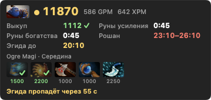

# Networth Overlay

**[English](README.en.md)** · Русский

Окно с нетворсом, таймерами и подсказками поверх Dota 2 на macOS. Работает и над полноэкранной игрой.



## Что показывает

- **Строка нетворса:** нетворс, GPM, XPM, портрет героя.
- **Показатели:** золото, выкуп, счёт, участие в убийствах, серия, добивания в минуту, итог на 10:00, APM, источники золота, варды, обычные GPM/XPM героя.
- **Таймеры:** руны усиления, богатства и мудрости, лотосы, стак, день и ночь, Терзатель, Рошан, Эгида.
- **Помощь:** популярные предметы героя по фазам матча с отметкой купленного, строка подсказок, звуковые сигналы (свой звук на каждое событие).
- **Режим зрителя** и **итоги последнего матча**.

Размер, раскладка, прозрачность, масштаб и набор показателей настраиваются. Интерфейс на русском и английском. `Ctrl+Shift+H` прячет и показывает окно.

## Установка

```bash
brew tap 6ermutka/networth-overlay https://github.com/6ermutka/networth-overlay
brew trust 6ermutka/networth-overlay
brew install --cask networth-overlay
```

Homebrew 7 и новее не загружает сторонние репозитории, пока вы явно им не доверились, — за это отвечает вторая команда.

Обновление — `brew upgrade --cask networth-overlay`. Приложение само проверяет новые версии и, если установлено через Homebrew, ставит их (не во время игры; отключается в настройках).

Без Homebrew: скачайте zip со [страницы релизов](https://github.com/6ermutka/networth-overlay/releases/latest), распакуйте в «Программы» и снимите карантин — приложение не подписано сертификатом разработчика Apple:

```bash
xattr -dr com.apple.quarantine "/Applications/Networth Overlay.app"
```

## Как пользоваться

1. Откройте Networth Overlay — появится окно настроек и значок «NW» в строке меню.
2. Нажмите «Играть»: Dota 2 запустится через Steam с параметром `-gamestateintegration`. Если запускаете игру из Steam сами, добавьте этот параметр в параметры запуска.
3. Окно появится в матче. Чтобы поставить его на место, нажмите «Переставить окно» и перетащите.

## Откуда данные и почему это не чит

- **Game State Integration** — официальный механизм Valve: Dota 2 сама отправляет данные вашего героя на `127.0.0.1`. Приложение только слушает локальный порт.
- Приложение не читает и не меняет память игры, не внедряется в её процесс и не подменяет файлы игры. Оно добавляет один файл `gamestate_integration_networth_overlay.cfg` в папку `cfg/gamestate_integration`.
- Данных о противниках во время вашего матча нет: игра их не отдаёт.
- **OpenDota** (`api.opendota.com`) — названия и цены предметов, популярные сборки, обычные GPM/XPM, итоги матча. Картинки предметов и героев — с CDN Steam. В запросах уходит только номер героя или матча; отключается одной галочкой.

Проект не связан с Valve. Dota 2 — товарный знак Valve Corporation.

## Ограничения

- Режим Turbo включается галочкой вручную: игра его не сообщает.
- Имена героев — на английском, как в OpenDota.
- Нужна macOS 13 или новее.

## Сборка из исходников

Нужны Xcode Command Line Tools.

```bash
./build.sh
```

Приложение появится в `build/Networth Overlay.app`. Релиз выпускается скриптом `./release.sh` после изменения номера в `VERSION`.

## Лицензия

MIT — см. [LICENSE](LICENSE).
